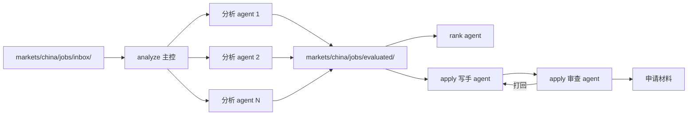

# GOAL — ai-job-search-cn 多 agent 改造

本文档是本仓库多 agent 改造的唯一目标定义。自主开发循环的每一轮从阅读本文档开始，达成与否由第 3 节的验收命令退出码判定，任何偏离第 4 节约束的行为都判定为违规。

## 1. 任务定义

把现有的单助手提示词工作区（markdown 工作流 + 确定性 Python 工具）改造为代码级编排的多 agent 系统：一个手搓的 Python 运行时驱动三种多 agent 协作模式完成求职工作流（岗位分析、申请材料生成、岗位排序），运行时自带验收循环，并带四条护栏保护的代码自改循环。

项目目的按优先级排序：

1. 作品集：可讲解、可演示、面试可追问的多 agent 工程，作为简历 Multi-Agent 关键词的支撑。
2. 自用：本人实际求职流程继续可用，真实个人资料保留在 gitignore 保护之下。

## 2. 架构决定（决策记录）

以下决定已经确认，开发循环不得偏离。

### 2.1 运行时：纯手搓

- 只依赖 `openai` Python SDK，全部走 OpenAI 兼容端点。
- 禁止引入任何 agent 框架（LangChain、LangGraph、CrewAI、AutoGen 等）。
- 自行实现的最小组件：agent 循环（请求 → 工具调用解析 → 执行 → 回填 → 终止判定）、`spawn` 工具（主控 agent 以工具调用形式启动子 agent 并阻塞等待结果）、调度器、trace 记录。

### 2.2 模型接入：端点可配置

- 通过环境变量配置：`JOBSEARCH_LLM_BASE_URL`、`JOBSEARCH_LLM_MODEL`、`JOBSEARCH_LLM_API_KEY`。
- DeepSeek、Qwen、智谱 GLM 等任何 OpenAI 兼容端点只改环境变量即可切换，代码零修改。
- 集成测试与评审层放开真实调用，不追求省 token。

### 2.3 改造范围：三个核心动作

| 动作 | 多 agent 模式 | 说明 |
| --- | --- | --- |
| analyze | 主控-执行者并行扇出 | 一个主控 agent 把 `markets/china/jobs/inbox/` 下每个岗位派发给一个分析 agent 并行执行，结果汇总落盘到 `markets/china/jobs/evaluated/` |
| apply | 生成-审查循环 | 写手 agent 生成申请材料（打招呼语、私信、求职信、简历修改建议），审查 agent 持有候选人证据文件与校验规则，打回修改直至通过或达到轮次上限 |
| rank | 汇总排序 | 单个 agent 读取全部评估产物做全局排序，读写共享目录（文件目录即共享数据） |

三个降级或最小实现：

- setup：单次 LLM 调用完成简历到资料文件的格式转换，不做成 agent。
- scrape：最小实现，仅保留无墙公开来源（公司官网、招聘公告）的抓取提示与手动投喂说明。
- interview：复用 apply 的生成-审查循环，替换 prompt 文件，不单独建设。

运行时结构（包内目录划分，实现层决定）：

```text
jobsearch_agents/
  runtime/     agent 循环、spawn、调度器、trace
  prompts/     分析、写手、审查、排序的 system prompt（从 markdown 工作流翻译）
  tools/       包装 tools/ 下现有脚本为 agent 工具（job_key、rank_state 等）
  actions/     六个动作的编排入口
  fixtures/    10 份虚构 JD 与虚构候选人资料
  cli.py       python -m jobsearch_agents <action> [args]
```



### 2.4 与原有体系的关系

- 原有 `markets/china/workflows/`、`agent-resources/` markdown 体系保持只读不动，继续服务 ZCode/Codex 手动入口。
- 工作流中的字段清单、红旗列表、评分规则、事实约束（`evidence.md` 不支持的表述禁止写成事实）翻译进 `jobsearch_agents/prompts/`，由代码加载。
- 双入口并存：`jobsearch_agents` 为代码入口，markdown 为手动入口，互不干扰。

### 2.5 测试策略：三层金字塔

1. 单元层（不调 LLM）：调度器、spawn、agent 循环、消息路由用脚本化假模型（固定工具调用序列，pytest 内注入）验证控制流。秒级完成，每次改动必跑。
2. 集成层（真实 LLM）：10 份虚构 fixtures（3 份高匹配、3 份中等匹配、2 份红旗岗位、2 份信息残缺）跑完整 analyze → rank → apply 管线，断言结构化产物。
3. 评审层（LLM-as-judge）：评审 agent 按评分标准给产物打分（事实一致性、无编造、格式合规、排序合理性），低于阈值即测试失败。

三层全部进 pytest，单元层默认运行，集成层与评审层挂 `integration` 标记。

### 2.6 真实数据的隔离

- 虚构 fixtures 只存在于 `jobsearch_agents/fixtures/` 与测试专用的临时目录。
- 真实个人资料继续在 `documents/china/profile/`（gitignore 保护下），演示与测试一律不读取。

## 3. 验收标准（可执行化）

达成判定：下表命令全部退出码 0。运行集成层命令前需设置第 2.2 节的环境变量。

| 编号 | 标准 | 命令 |
| --- | --- | --- |
| A1 | 单元层全绿：agent 循环、spawn、调度器、审查打回逻辑的控制流正确 | `pytest tests/unit/ -q` |
| A2 | 原有测试零回归：现有 39 个测试不因改造失败 | `pytest tests/ -q --ignore=tests/unit --ignore=tests/acceptance` |
| A3 | analyze 产物完整：10 份 fixtures 每份产出评估文件，必填节（评分、优势、差距、红旗、缺失信息）齐全 | `pytest tests/acceptance/ -m integration -q -k analyze` |
| A4 | 红旗检出：2 份红旗 fixtures 的评估报告包含对应红旗标记（低基数社保、超长试用期、外包模糊等） | `pytest tests/acceptance/ -m integration -q -k red_flag` |
| A5 | rank 排序正确：高匹配组排序位置整体高于中等组 | `pytest tests/acceptance/ -m integration -q -k rank` |
| A6 | apply 产物完整且无编造：每份申请材料含打招呼语、私信、求职信、简历修改建议四节；评审 agent 未发现证据文件不支撑的事实表述 | `pytest tests/acceptance/ -m integration -q -k apply` |
| A7 | 评审层达标：评审 agent 对全部产物打分不低于阈值（默认 0.8，评测 prompt 内逐条给依据） | `pytest tests/acceptance/ -m integration -q -k judge` |
| A8 | trace 完整：一次完整运行后，每次 LLM 调用的输入输出、token 数、耗时都有 trace 记录 | `pytest tests/acceptance/ -m integration -q -k trace` |
| A9 | 端点切换零改码：仅改环境变量即可切换模型端点并完整跑通 analyze | `pytest tests/acceptance/ -m integration -q -k endpoint_switch` |

## 4. 约束与护栏

自改循环允许修改除以下冻结对象之外的一切代码。冻结对象：

- tests/ 目录下全部测试文件与 conftest，验收命令本身（第 3 节表格）。
- GOAL.md 本身。
- `markets/china/workflows/`、`agent-resources/`、`templates/`、`cv/`、`cover_letters/` 等原有 markdown 体系与 LaTeX 模板。
- `documents/` 下任何个人数据。
- 对 prompt 文件（prompts/）的修改不设冻结，但修改后评审层必须重新通过，评审 prompt 中评分标准的任何放宽都会被 A7 的人审门禁发现。

四条护栏：

1. 测试冻结：每轮自改结束后用 `git diff --name-only` 校验本轮变更文件，触碰冻结对象即该轮作废。
2. git 检查点：每轮自改开始前自动 commit 一次，提交信息带轮次编号。某个检查点之后的变更是否保留，由人审门禁决定。
3. 预算上限：自改循环最多 10 轮；token 总预算默认 5,000,000，环境变量 `JOBSEARCH_LOOP_TOKEN_BUDGET` 可调整。任一超限立即停机并输出最终报告，不允许继续。
4. 人审门禁：全部验收命令退出码 0 之后，循环再输出每轮 commit 列表与总体 diff 报告；人审查通过后本次改造才算完成。审查发现测试被迁就（例如无关断言被删除的痕迹会体现在冻结校验里）即整体退回。

## 5. 开发循环协议

自主开发循环由 ZCode 执行，每一轮固定七个步骤：

1. 通读 GOAL.md。
2. 依次运行第 3 节验收命令清单，记录失败项。
3. 把每条失败映射回对应的验收编号与代码位置。
4. 修改代码。修改前执行 git 检查点；触碰冻结对象的行为在第 4 节校验下作废。
5. 重跑受影响的验收命令，确认修复。
6. git commit，提交信息写明本轮修复的验收编号。
7. 若全部验收通过：执行冻结校验与预算核对，生成人审报告（每轮 commit、总 diff、验收输出），停机等待人审；若未通过：进入下一轮，直至全绿或预算耗尽。

循环的中间产物（trace、运行日志、人审报告）统一写入 `runs/` 目录，该目录保持 gitignore。禁止为了通过测试而使用任何 mock、伪造数据或迁就断言的手段；单元层的脚本化假模型仅用于验证控制流，集成层与评审层必须真实调用模型。
