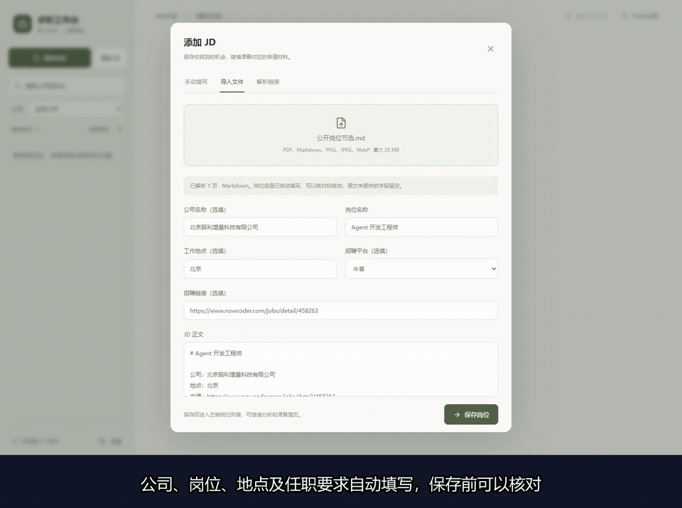
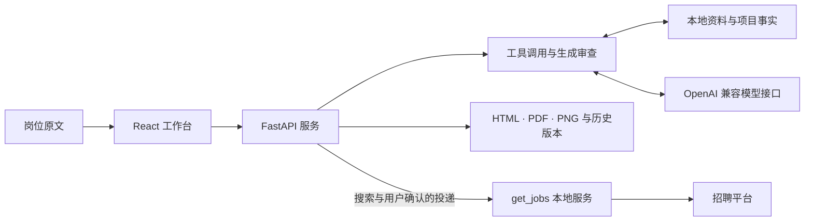

<p align="center">
  
</p>

<p align="center">
  <a href="https://github.com/tiankuolu/ai-job-search-cn/actions/workflows/ci.yml"></a>
  <a href="SETUP.md"></a>
  <a href="LICENSE"></a>
</p>

<p align="center">
  <a href="#操作演示">看演示</a> · <a href="#快速开始">交给智能体安装</a> · <a href="#安装前准备">准备配置</a> · <a href="SETUP.md">手动启动</a> · <a href="#参与改进">提交意见</a>
</p>

这是一个在本地运行的实习求职工作台。保存完整 JD，结合真实项目事实准备申请材料，直接编辑简历，核对后确认申请；岗位、材料版本与申请结果一起保存。

## 操作演示

[](docs/demo.md)

**[下载二十二秒演示视频](https://raw.githubusercontent.com/tiankuolu/ai-job-search-cn/main/docs/media/workbench-demo.mp4)** · [查看静态截图](docs/media/workbench-preview.png) · [录制说明](docs/demo.md)

演示来自真实页面和模型请求，使用公开岗位与空白候选人档案，展示字段提取、岗位保存和分析结果。

## 如何处理一份申请

1. **收集岗位**：填写 JD，导入 Markdown、PDF 或图片，或解析招聘链接，核对公司、职责与来源。
2. **按事实准备材料**：读取本人资料与项目证据，分析岗位要求，经过生成、审查与修改，准备简历和打招呼语。
3. **编辑并确认**：直接修改 HTML 简历，自动保存并保留版本，导出 PDF、HTML 和 PNG；按需生成英文简历、项目介绍与自我描述。
4. **申请并记录结果**：确认材料与平台登录状态后提交，根据实际回执区分已投递和待核实，防止同一公司同名岗位重复联系。

工作台支持按公司、岗位与申请状态筛选。不同岗位的材料任务可以并发，同一岗位的生成、编辑与投递互相保护。命令行还提供岗位排序、公司调研、面试准备、故事库和练习评分。

## 快速开始

把下面整段提示词交给你使用的编码智能体。它会检查环境、安装依赖、配置资料并启动验证；模型与个人资料由你提供。

```text
请安装并运行 https://github.com/tiankuolu/ai-job-search-cn 。
我授权你创建本地工作目录、安装所需依赖并启动服务。

读取仓库 AGENTS.md、SETUP.md 和 docs/agent-install.md，
按完整安装流程检查环境、模型连接、个人资料与项目事实档案。
保留已有文件；缺少的个人信息、API 配置和依赖位置集中向我询问。
个人经历和贡献只能采用我提供的真实依据，密钥不得出现在回复或日志中。

实际启动工作台，验证页面、公开示例 JD 导入、模型请求和相关检查，
修复发现的问题。完成后给出打开地址、配置位置和真实验证结果。
个人资料与运行数据保留在本地，发布与投递按我的明确授权执行。
```

[完整安装提示词](docs/agent-install.md) · [手动安装与运行](SETUP.md) · [首次申请操作](docs/first-application.md)

## 安装前准备

### 模型与个人资料

- **模型连接**：提供 OpenAI 兼容接口地址、模型名称与 API Key。程序通过 `JOBSEARCH_LLM_BASE_URL`、`JOBSEARCH_LLM_MODEL`、`JOBSEARCH_LLM_API_KEY` 读取配置；模型需要支持工具调用和 JSON 输出。
- **个人资料 `candidate.md`**：姓名、手机、邮箱、城市、GitHub 或作品集链接，以及真实教育经历；GPA 按原始资料填写，未提供时留空。
- **求职偏好 `preferences.md`**：岗位方向、城市、薪资与工作制度偏好，以及每周可到岗天数、可持续实习月数和可到岗时间。
- **成果依据**：`evidence.md` 保存成果与来源；`个人资料/项目事实档案/index.json` 及其引用的 Markdown 保存项目贡献、稳定事实编号和验证结果。

当前简历格式需要至少两个相关项目、两条有依据的技能，以及至少一条真实的荣誉、竞赛或语言条目。固定荣誉与语言条目配置在 `preferences.md` 的 `resume.fixed_awards`；其他技能和经历偏好见 [资料格式](docs/profile-format.md)。

个人材料默认保存在仓库同级的 `jobsearch-workspace/求职材料/`。已有资料可以通过 `JOBSEARCH_WORKSPACE_ROOT` 和 `JOBSEARCH_MATERIALS_ROOT` 指定位置，安装过程保留当前文件。

### 运行环境

- **基础环境**：Windows PowerShell、Git、Python 3.11、Node.js 22 与 npm。Python 依赖来自 `requirements-web.txt`，前端依赖由 `frontend/package-lock.json` 锁定。
- **文档与浏览器工具**：Edge 或 Chrome、Playwright、Poppler 的 `pdftoppm`，用于网页操作、浏览器 PDF 导出与预览图生成。
- **完整招聘流程**：另外需要 JDK 21、Gradle，以及兼容 `/api/jobsearch/*` 的 `get_jobs` 本地服务及其发行版数据库。源码目录按 `start-integrated.ps1` 中的 `../../get_jobs` 解析，安装时核对实际位置。

本地工具通过 `tools/setup_delivery.py` 配置，招聘账号由本人完成登录。接口、目录与启动步骤见 [招聘服务配置](docs/automatic-delivery.md)。

## 数据与隐私

个人档案、求职材料和招聘登录状态保存在本地。模型分析会把当前任务所需资料发送给你配置的模型服务，使用前请确认服务商与处理范围。

`runs/` 保存模型输入输出、任务记录和材料版本，`.artifacts/` 保存验证中间文件。这些目录与密钥、Cookie、浏览器用户目录、数据库和个人材料均受到 Git 忽略保护；提交检查还会阻止已跟踪的私人配置与运行资料进入仓库。

## 开发与实现

<details>
<summary>查看程序结构、常用命令与开发检查</summary>



- `frontend/`：React、TypeScript 工作台和材料编辑界面。
- `jobsearch_agents/actions/`：分析、申请、排序、调研与面试动作。
- `jobsearch_agents/runtime/`：模型调用、工具执行、并行任务与调用记录。
- `jobsearch_agents/delivery/`：岗位导入、材料生成、导出、版本与投递管理。
- `markets/china/`：中文资料模板、写作规范与助手工作流。
- `third_party/asu-skills/`：固定版本的简历规范、模板与编辑组件。

常用命令：

```powershell
py -3.11 -m jobsearch_agents --help
py -3.11 -m jobsearch_agents analyze
py -3.11 -m jobsearch_agents apply '求职材料/公司-岗位/岗位JD.md'
py -3.11 -m jobsearch_agents rank
py -3.11 -m jobsearch_agents status
```

命令行岗位路径相对工作区解析，也可以提供完整路径。完整简历制作命令见 [SETUP.md](SETUP.md)。

开发检查：

```powershell
New-Item -ItemType Directory -Path .artifacts -Force
py -3.11 tools/lint_skills.py
py -3.11 tools/security_guards.py
py -3.11 tools/check_ui_contract.py --check
py -3.11 -m pytest tests/test_workspace_layout.py tests/test_security_guards.py -q --basetemp=.artifacts/pytest
npm --prefix frontend test
npm --prefix frontend run build
```

真实模型和浏览器验证需要相应的本地配置，执行要求见 [AGENTS.md](AGENTS.md)。[Codex](docs/codex.md)、[ZCode](docs/zcode.md) 也可以通过 [项目技能](.agents/skills/china-job-search/SKILL.md) 使用相同的资料与工作流。

</details>

## 参与改进

如果这个项目对你有帮助，记得点击右上角的 **Star ⭐**，也方便以后找到它。

欢迎通过 [Issues](https://github.com/tiankuolu/ai-job-search-cn/issues) 提交使用意见、问题与功能建议，也欢迎通过 [Pull Request](https://github.com/tiankuolu/ai-job-search-cn/pulls) 改进代码、文档或演示。反馈时请附上操作步骤、运行环境、预期与实际结果，分享截图和日志前清除个人信息与密钥。

一起让这个项目变得更好。

## 来源与许可

基于 [MadsLorentzen/ai-job-search](https://github.com/MadsLorentzen/ai-job-search) 开发，保留其 [MIT License](LICENSE)。简历规范与模板引入自 [Hisn00w/ASu-skills](https://github.com/Hisn00w/ASu-skills)，固定版本和许可见 [来源说明](third_party/asu-skills/SOURCE.md) 与 [许可全文](third_party/asu-skills/LICENSE)。`get_jobs` 作为独立本地服务，遵循其原项目许可。
