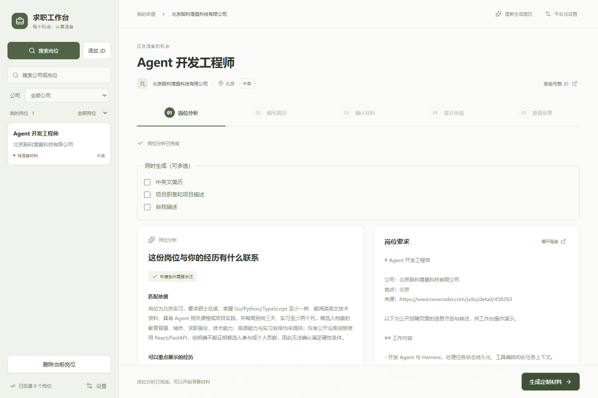
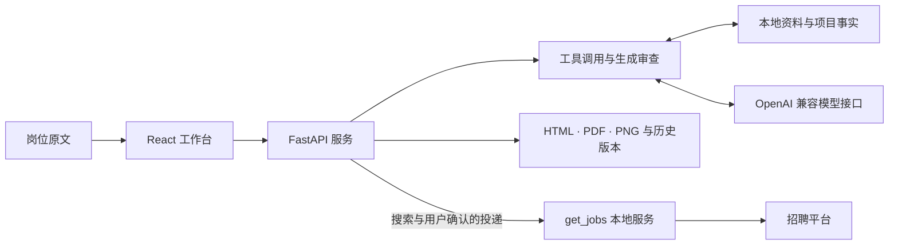

# 中国实习求职 Agent

[](https://github.com/tiankuolu/ai-job-search-cn/actions/workflows/ci.yml)
[](SETUP.md)
[](frontend/package.json)
[](LICENSE)

把岗位原文、项目事实、简历修改与申请记录放进同一个工作台。模型负责读取资料、分析岗位、编写和审查材料；你可以直接编辑简历，核对结果后确认发送。

## 操作演示

[](docs/media/workbench-demo.mp4)

**[观看 MP4 演示](docs/media/workbench-demo.mp4)** · [下载视频](https://raw.githubusercontent.com/tiankuolu/ai-job-search-cn/main/docs/media/workbench-demo.mp4) · [演示内容与录制说明](docs/demo.md)

视频录制真实工作台：导入公开 JD、调用模型提取字段、保存岗位、查看原文、分析资料缺失和选择后续材料。演示使用空白候选人档案，个人信息与招聘账号保持私密。

## 可以完成什么

- **收集岗位**：手动填写 JD，导入 Markdown、PDF 或图片，或解析招聘链接；保留完整原文与来源，核对后保存。
- **分析匹配**：结合当前资料和项目事实，区分岗位要求、相关证据与缺失信息；同一份 JD 的分析结果可以复用。
- **编写定制材料**：按岗位选择项目与表达重点，通过生成、审查和修改循环准备中文简历及打招呼语；按需生成英文简历、项目职责与描述、自我描述。
- **编辑与导出**：直接修改 HTML 简历，自动保存正文；保留历史版本，导出 HTML、A4 PDF 与 PNG，检查文字、链接和页面边界。
- **管理多个机会**：按公司、岗位和申请状态筛选；不同岗位的材料任务可以并发，同一岗位的生成、编辑与投递互相保护。
- **确认申请与跟进**：通过本地招聘服务检查登录与发送结果，区分已投递和待核实；同一公司同名岗位的重复联系会被阻止。

命令行另提供岗位排序、公司调研、面试准备、故事库和练习评分。Codex、ZCode 可以通过项目技能读取相同资料并执行工作流。

## 如何处理一份申请

1. 保存完整 JD，核对公司、岗位和来源。
2. 读取本人资料与项目事实，检查匹配依据。
3. 按岗位生成简历与沟通材料，审查事实、贡献和指标条件。
4. 查看生成结果，直接修改简历与打招呼语，保留每次版本。
5. 导出并核对文件，再确认申请；根据实际回执记录结果。

生成稿会检查 A4 单页、页面占用和最小字号。人工编辑后的正文按当前内容直接导出，保留编辑结果，并检查导出文件与当前版本一致。

## 快速启动

以下命令使用 Windows PowerShell。需要 Python 3.11、Node.js 22，以及用于简历导出的 Edge 或 Chrome。

### 安装项目

```powershell
git clone https://github.com/tiankuolu/ai-job-search-cn.git
cd ai-job-search-cn
py -3.11 -m pip install -r requirements-web.txt
npm --prefix frontend ci
npm --prefix frontend run build
```

### 准备本地资料

按 [SETUP.md](SETUP.md) 创建工作区，复制空白资料模板并填写真实信息；按 [资料格式](docs/profile-format.md) 配置项目事实档案。

- `candidate.md`：身份、联系方式和教育等个人信息。
- `preferences.md`：岗位方向、城市、到岗安排与材料偏好。
- `evidence.md`：可核验成果与来源。
- `项目事实档案/index.json` 及引用的 Markdown：项目事实与稳定编号。

默认工作区为仓库同级的 `jobsearch-workspace/`，个人材料保存在其中的 `求职材料/`。已有资料可以通过 `JOBSEARCH_WORKSPACE_ROOT` 和 `JOBSEARCH_MATERIALS_ROOT` 指定位置。

### 配置模型与启动界面

程序使用 OpenAI 兼容接口。按服务商提供的值填写接口地址与模型名称，密钥输入会隐藏：

```powershell
$env:JOBSEARCH_LLM_BASE_URL = Read-Host 'OpenAI 兼容接口地址'
$env:JOBSEARCH_LLM_MODEL = Read-Host '模型名称'
$env:JOBSEARCH_LLM_API_KEY = [System.Net.NetworkCredential]::new('', (Read-Host '模型 API Key' -AsSecureString)).Password
.\start-web.ps1 -SkipBuild
```

打开 [本地工作台](http://127.0.0.1:8765)。首次安装也可以使用 `.\start-web.ps1 -InstallDependencies` 完成 Python 依赖安装与前端构建。

完整搜索、材料生成和投递流程需要配置相邻的 `get_jobs` 本地服务。所需 Java 21、Gradle、浏览器及 PDF 工具的配置见 [自动搜索与简历投递](docs/automatic-delivery.md)，配置完成后使用 `.\start-integrated.ps1 -Build` 启动。

### 命令行与助手入口

```powershell
py -3.11 -m jobsearch_agents --help
py -3.11 -m jobsearch_agents analyze
py -3.11 -m jobsearch_agents apply '求职材料/公司-岗位/岗位JD.md'
py -3.11 -m jobsearch_agents rank
py -3.11 -m jobsearch_agents status
```

命令行岗位路径相对工作区解析，也可以填写完整路径。简历制作命令中的 `--job` 和 `--output` 使用实际文件位置：

```powershell
py -3.11 -m tools.make_resume --job '<岗位JD完整路径>' --output '<尚不存在的输出目录>'
```

- [首次申请操作](docs/first-application.md)
- [Codex 使用说明](docs/codex.md) / [ZCode 使用说明](docs/zcode.md)
- [助手技能入口](.agents/skills/china-job-search/SKILL.md)

## 程序结构



- `frontend/`：React、TypeScript 工作台，岗位与材料编辑界面。
- `jobsearch_agents/actions/`：分析、申请、排序、调研与面试动作。
- `jobsearch_agents/runtime/`：模型调用、工具执行、并行任务与调用记录。
- `jobsearch_agents/delivery/`：岗位导入、材料生成、导出、版本和投递管理。
- `markets/china/`：中文资料模板、写作规范和助手工作流。
- `third_party/asu-skills/`：固定版本的简历规范、模板与编辑组件。
- `tests/`、`tools/`：程序验证与检查工具。

## 本地数据与隐私

个人档案、求职材料和招聘登录状态保存在本地。模型分析会读取当前任务所需资料并发送给你配置的模型服务；使用前应确认服务商及处理范围。

`runs/` 会保存模型输入输出、任务记录与材料版本；`.artifacts/` 保存验证中间文件。它们与密钥、Cookie、浏览器用户目录、数据库和个人材料均受到 Git 忽略保护。提交检查还会阻止已跟踪的私人配置与运行资料进入仓库。

## 开发检查

```powershell
New-Item -ItemType Directory -Path .artifacts -Force
py -3.11 tools/lint_skills.py
py -3.11 tools/security_guards.py
py -3.11 tools/check_ui_contract.py --check
py -3.11 -m pytest tests/test_workspace_layout.py tests/test_security_guards.py -q --basetemp=.artifacts/pytest
npm --prefix frontend test
npm --prefix frontend run build
```

真实模型、浏览器和资料验证需要相应本地配置，执行要求见项目 [AGENTS.md](AGENTS.md)。

## 来源与许可

基于 [MadsLorentzen/ai-job-search](https://github.com/MadsLorentzen/ai-job-search) 开发，保留其 [MIT License](LICENSE)。简历规范与默认模板引入自 [Hisn00w/ASu-skills](https://github.com/Hisn00w/ASu-skills)，固定版本及许可见 [来源说明](third_party/asu-skills/SOURCE.md) 和 [许可全文](third_party/asu-skills/LICENSE)。

`get_jobs` 作为独立本地服务，通过 HTTP 提供招聘浏览器能力，遵循其原项目许可。
