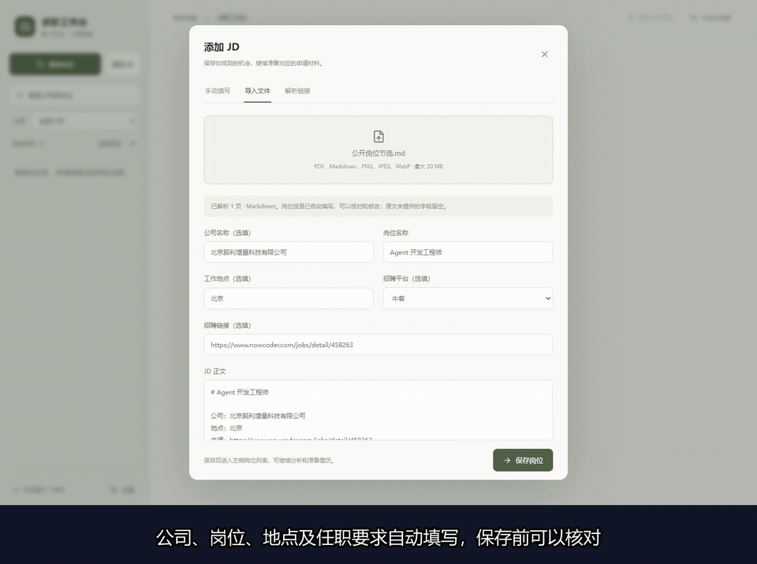

# 工作台操作演示

[下载完整 MP4](https://raw.githubusercontent.com/tiankuolu/ai-job-search-cn/main/docs/media/workbench-demo.mp4) · [静态截图](media/workbench-preview.png)

录制日期：2026-11-06。时长约一分二十六秒，含中文字幕。
上方动画为完整视频的操作节选，可以直接在 README 与此页查看。

## 视频内容

- 打开真实的 React 与 FastAPI 工作台。
- 导入 Markdown 格式的公开岗位信息，调用真实模型提取字段。
- 核对公司、岗位、地点与任职条件，保存到岗位列表。
- 查看完整岗位原文及来源，再调用模型分析当前资料与岗位的关系。
- 在空白候选人档案下展示资料缺失，按岗位筛选并选择后续材料类型。

本段录屏展示岗位导入与分析。简历生成、编辑、导出与投递的使用方法见 [工作流说明](automatic-delivery.md)。

## 演示资料

岗位来源：[牛客公开招聘页面](https://www.nowcoder.com/jobs/detail/458263)。录制使用其公开职责和要求的节选与转述，文件保存在 [公开岗位节选](examples/public-agent-jd.md)。招聘状态以原始页面为准。

候选人档案采用空白模板；项目资料仅描述公开仓库功能，并明确没有提供候选人身份或个人贡献。模型实际返回资料不足的判断，录制中保留了这一结果。

视频通过 Playwright 录制真实页面操作，封装为 H.264 MP4 并添加中文字幕。没有提交申请或联系招聘者。
